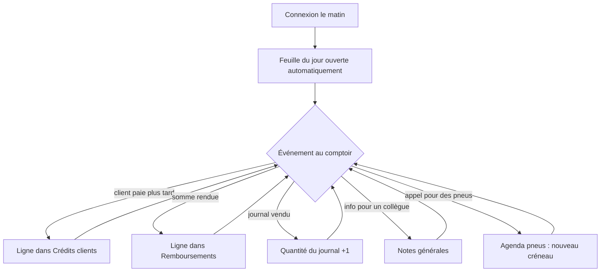

# Parcours utilisateurs

> Statut : **Stable**

## Journée type au comptoir

1. L'utilisateur se connecte une fois ; la session tient la journée sans redemander le mot de
   passe ([E01](../10-user-stories/E01-authentification.md)).
2. La feuille du jour s'ouvre ; si elle n'existe pas encore elle est créée vide
   ([E02](../10-user-stories/E02-feuille-du-jour.md)).
3. Chaque saisie s'enregistre seule ([E09](../10-user-stories/E09-transverse.md)).

## Retrouver une saisie passée

L'utilisateur choisit une date dans le sélecteur de la feuille, ou recule jour par jour. La
feuille de ce jour s'affiche avec ses lignes, modifiables comme celles du jour.

## Prendre un rendez-vous pneus

L'utilisateur ouvre l'agenda, se place sur la semaine voulue, clique une plage libre, renseigne
le client et le véhicule dans la modale et valide. S'il faut décaler, il fait glisser le
créneau ([E07](../10-user-stories/E07-rendez-vous-pneus.md)).

## Changer la liste des journaux

Un titre n'est plus distribué : un utilisateur le désactive dans l'administration. Il disparaît
des nouvelles feuilles mais reste visible, avec ses quantités, sur les feuilles passées
([E08](../10-user-stories/E08-administration.md)).
