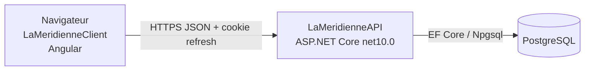

# Architecture

> Statut : **Stable** · Décision : [ADR-0001](../40-decisions/ADR-0001-architecture-simple.md)

## Vue d'ensemble



Une API, une base. Aucun service tiers, aucune file de messages, aucun cache distribué.

## Pile

| Élément | Choix |
|---|---|
| Runtime | .NET 10, ASP.NET Core, contrôleurs (`[ApiController]`) |
| Persistance | EF Core 10 + `Npgsql.EntityFrameworkCore.PostgreSQL`, migrations EF |
| Authentification | `Microsoft.AspNetCore.Authentication.JwtBearer` ([ADR-0002](../40-decisions/ADR-0002-jwt-et-refresh-token.md)) |
| Hachage | `PasswordHasher<User>` d'ASP.NET Core Identity (sans le reste d'Identity) |
| Validation | DataAnnotations + validations explicites dans les services |
| Documentation | `Microsoft.AspNetCore.OpenApi` (déjà présent), document servi en développement |
| Erreurs | `ProblemDetails` (`AddProblemDetails`, gestionnaire d'exceptions global) |

## Organisation du code (cible)

```
LaMeridienneAPI/
  Controllers/      un contrôleur par ressource, mince : validation d'entrée, appel service
  Services/         règles métier, une classe par domaine (SheetService, AppointmentService…)
  Data/             AppDbContext, configurations EF, migrations, seed
  Models/           entités EF
  Dtos/             contrats d'entrée/sortie, jamais d'entité exposée
  Auth/             émission et rotation des jetons, politique Admin
```

Un seul projet. Pas de dépôt générique (`Repository<T>`) ni de médiateur : les services
utilisent `AppDbContext` directement.

## Fuseau horaire

L'API reçoit et rend des instants en UTC (ISO 8601 avec `Z`). Seule la notion de « jour »
d'une feuille dépend du fuseau `Europe/Paris` ([R-01](../20-specs-fonctionnelles/01-regles-metier.md#r-01--date-dune-feuille)),
injecté via `TimeProvider` pour être testable.

## CORS

En développement, le client tourne sur `http://localhost:4200` : CORS autorise cette origine
**avec identifiants** (cookie de renouvellement). En production, client et API sont servis sous
le même domaine ([exploitation](05-exploitation.md)).
