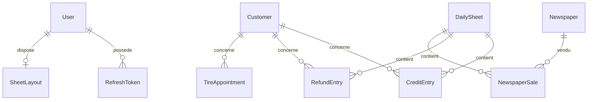

# Modèle de données

> Statut : **Brouillon** — à confirmer à la première migration.

Toutes les clés primaires sont des `Guid` (v7, ordonnés). Les instants sont des
`timestamptz`. Les colonnes d'audit `CreatedAt`, `CreatedById`, `UpdatedAt`, `UpdatedById`
sont posées par un intercepteur EF à partir de l'utilisateur courant
([US-E09-03](../10-user-stories/E09-transverse.md#us-e09-03--savoir-qui-a-noté-quoi)).

| Entité | Champs | Contraintes |
|---|---|---|
| `User` | `Id`, `UserName`, `DisplayName`, `PasswordHash`, `FailedLoginCount`, `LockedUntil` | `UserName` unique |
| `RefreshToken` | `Id`, `UserId`, `TokenHash`, `ExpiresAt`, `ConsumedAt`, `RevokedAt`, `ReplacedById` | `TokenHash` unique ; jamais le jeton en clair |
| `SheetLayout` | `UserId`, `Sections` (`jsonb`) | une par utilisateur ; contenu validé ([R-07](../20-specs-fonctionnelles/01-regles-metier.md#r-07--disposition-des-cases)) |
| `DailySheet` | `Id`, `Date` (`date`), `Notes`, `NotesVersion` | `Date` unique ; `Notes` ≤ 10 000 caractères ; `NotesVersion` jeton de concurrence |
| `Customer` | `Id`, `Name`, `NormalizedName`, `Phone`, `MergedIntoId` | `NormalizedName` unique (sans casse ni accents, [R-08](../20-specs-fonctionnelles/01-regles-metier.md#r-08--référentiel-clients)) ; index trigramme pour la recherche |
| `CreditEntry` | `Id`, `SheetId`, `CustomerId`, `Amount`, `Comment`, `DeletedAt` + audit | `Amount numeric(10,2)` > 0 |
| `RefundEntry` | mêmes champs que `CreditEntry` | idem |
| `Newspaper` | `Id`, `Name`, `IsActive`, `SortOrder` | nom unique sans casse ; jamais supprimé |
| `NewspaperSale` | `SheetId`, `NewspaperId`, `Quantity` + audit | clé `(SheetId, NewspaperId)` ; `0 ≤ Quantity ≤ 999` |
| `TireAppointment` | `Id`, `Start`, `End`, `CustomerId`, `Phone`, `Vehicle`, `Service`, `Note`, `DeletedAt` + audit | `End > Start` ; index sur `Start` |

Crédits et remboursements sont deux tables distinctes plutôt qu'une table typée : ils sont
indépendants ([R-04](../20-specs-fonctionnelles/01-regles-metier.md#r-04--crédits-et-remboursements-sont-indépendants))
et pourront diverger.

Les lectures filtrent `DeletedAt IS NULL` par un filtre global EF
([R-06](../20-specs-fonctionnelles/01-regles-metier.md#r-06--suppression-logique)).

## Données initiales

- Trois `User` depuis la configuration ([ADR-0003](../40-decisions/ADR-0003-comptes-pre-crees.md)).
- `Newspaper` : « Sud Ouest » (ordre 1), « Le Républicain » (ordre 2), actifs.
