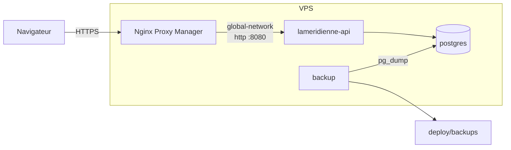

# Exploitation

> Statut : **Stable**

## Développement local

```bash
cp .env.example .env                   # lu par l'API et par compose.yaml ; POSTGRES_PORT=5433 si le port est pris
docker compose up -d --wait postgres   # PostgreSQL 17 sur localhost:$POSTGRES_PORT
dotnet run --project LaMeridienneAPI.csproj   # http://localhost:5095, https://localhost:7093
curl localhost:5095/health                    # Healthy
```

À chaque démarrage, dans tous les environnements, l'API applique les migrations en attente et
crée la base si elle n'existe pas, y compris sur un PostgreSQL déjà présent sur la machine
(l'utilisateur de `.env` doit alors avoir le droit `CREATEDB`).

Les comptes sont créés au démarrage s'ils n'existent pas ; sur une base sans comptes, l'API
refuse de démarrer tant qu'une variable `SEED_USER_n_*` manque, et la nomme. Un mot de passe
oublié se remplace en base (hachage `PasswordHasher` d'ASP.NET Core Identity).

`compose.yaml` déclare un service `postgres` avec un volume nommé `pgdata` ; ses identifiants
ne servent qu'au développement. Le dossier contient le projet et la solution : les commandes
`dotnet` précisent donc la cible (`LaMeridienneAPI.csproj` ou `LaMeridienne.slnx`).

## Tests

```bash
dotnet test LaMeridienne.slnx   # Docker doit tourner : Testcontainers lance PostgreSQL 17
```

## Production



[`deploy/compose.prod.yaml`](../../deploy/compose.prod.yaml) décrit trois services :

| Service | Rôle |
|---|---|
| `postgres` | PostgreSQL 17, volume `pgdata`, joignable seulement sur le réseau interne |
| `api` | l'API (`mcr.microsoft.com/dotnet/aspnet:10.0`, utilisateur non root, port 8080) ; attend que `postgres` soit prêt, applique les migrations en attente puis crée les comptes manquants |
| `backup` | une sauvegarde `pg_dump` par jour, voir plus bas |

TLS, nom de domaine et certificats sont tenus par **Nginx Proxy Manager** (NPM), déjà en place
sur le VPS. Il joint l'API par le réseau Docker externe `global-network` (variable
`PROXY_NETWORK`) sous le nom `lameridienne-api`. Aucun port n'est publié sur l'hôte. Le client
Angular est servi sous le même domaine (`/` → `lameridienne-client`, `/api` et `/health` → API) :
pas de CORS en production. Son conteneur et le réglage de NPM sont décrits dans
l'[exploitation du client](https://github.com/mahdimcheik/LaMeridienneClient/blob/main/docs/30-specs-techniques/09-exploitation.md#premier-déploiement).

L'API fait confiance aux en-têtes `X-Forwarded-For` / `X-Forwarded-Proto`
(`ASPNETCORE_FORWARDEDHEADERS_ENABLED=true`). La limitation de débit compte donc par adresse de
client, et les requêtes arrivées en HTTPS au proxy sont vues comme HTTPS. C'est sûr parce que
seul le proxy peut joindre l'API : ne jamais publier son port.

### Premier déploiement

```bash
git clone https://github.com/mahdimcheik/LaMeridienneAPI.git && cd LaMeridienneAPI
cp deploy/.env.example deploy/.env      # mot de passe PostgreSQL, JWT_KEY, trois comptes
chmod 644 deploy/.env                   # monté en lecture seule, lu par l'utilisateur non root du conteneur
docker compose -f deploy/compose.prod.yaml up -d --build
docker compose -f deploy/compose.prod.yaml ps   # les trois services « running »
```

Dans NPM : un *Proxy Host* pour le domaine, *Forward Hostname* `lameridienne-api`, port
`8080`, schéma `http`, certificat Let's Encrypt et *Force SSL*. Vérifier ensuite
`https://<domaine>/health` → `Healthy`. Les variables `SEED_USER_*` ne servent qu'au premier
démarrage : une fois les comptes en base, elles peuvent être vidées.

### Mise à jour

```bash
git pull
docker compose -f deploy/compose.prod.yaml up -d --build   # l'API applique les migrations en attente au démarrage
```

Une migration qui échoue arrête le démarrage : le conteneur redémarre en boucle
(`docker compose -f deploy/compose.prod.yaml logs api` donne l'erreur) et la base reste dans
l'état de la dernière migration réussie.

## Sauvegarde

Le service `backup` lance [`deploy/backup.sh`](../../deploy/backup.sh) : chaque jour à
`BACKUP_TIME` (03:00, heure de Paris), un `pg_dump` au format *custom* dans
`deploy/backups/lameridienne-AAAA-MM-JJ.dump`. Les fichiers de plus de `BACKUP_RETENTION_DAYS`
jours (30) sont supprimés. Sauvegarde immédiate :
`docker compose -f deploy/compose.prod.yaml exec backup bash /backup.sh --now`.

Le dossier reste sur le VPS : **la copie hors de la machine est obligatoire** et se fait par une
tâche de l'hôte. C'est la seule mesure qui protège l'historique des feuilles. Par exemple, en
crontab :

```bash
30 3 * * * rsync -a --delete /chemin/LaMeridienneAPI/deploy/backups/ nas:/sauvegardes/lameridienne/
```

### Restauration

- **Répétition** (sans toucher la production) : [`deploy/check-restore.sh`](../../deploy/check-restore.sh)
  restaure la sauvegarde la plus récente (ou celle donnée) dans une base temporaire et compare
  le nombre de lignes par table avec la production. L'historique des migrations et les comptes
  doivent être identiques. Un écart sur les autres tables est seulement signalé (saisies
  faites depuis la sauvegarde). La base temporaire est ensuite supprimée. À lancer après la mise
  en service, puis après chaque changement de schéma.
- **Restauration réelle** : [`deploy/restore.sh`](../../deploy/restore.sh) `<fichier>` arrête
  l'API, remplace la base par la sauvegarde (`pg_restore --clean`), puis redémarre l'API.
  Après une restauration, ce qui a été saisi depuis la sauvegarde est perdu.

## Intégration continue

[`.github/workflows/ci.yml`](../../.github/workflows/ci.yml), à chaque *push* ou *pull request*
vers `main` : build, tests (PostgreSQL par Testcontainers), `./docs/check-docs.sh`, puis
construction de l'image Docker.

## Journaux

Journalisation structurée par défaut d'ASP.NET Core, lue par
`docker compose -f deploy/compose.prod.yaml logs api`. Jamais de mot de passe, de jeton ou de
corps de requête d'authentification dans les journaux.
