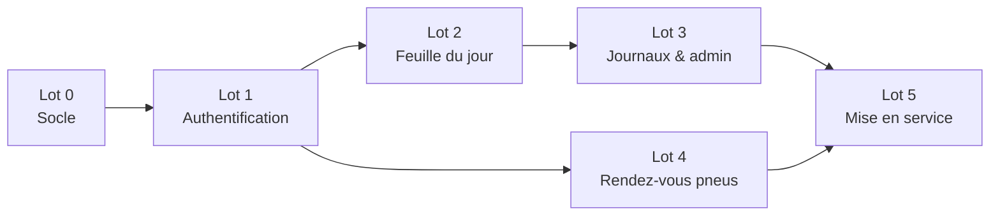

# Feuille de route et tâches

> Statut : **Stable** — ordre de travail, pas un calendrier. Chaque lot est livrable seul,
> vérifiable indépendamment, et met à jour les lignes `État` / `Application` qu'il rend fausses.
> Côté front : feuille de route de `LaMeridienneClient/docs/50-backlog/01-feuille-de-route.md`,
> dont les lots portent les mêmes numéros.

---

## Lot 0 — Socle

**Objectif :** un projet qui démarre sur PostgreSQL, testable, sans reliquat du modèle.

- [x] Supprimer `WeatherForecast.cs` et `Controllers/WeatherForecastController.cs`.
- [x] Ajouter EF Core + Npgsql, `AppDbContext`, première migration vide.
- [x] `compose.yaml` avec PostgreSQL 17 et volume nommé.
- [x] `AddProblemDetails`, gestionnaire d'exceptions global, messages en français.
- [x] `TimeProvider` injecté, fuseau `Europe/Paris` en configuration.
- [x] Intercepteur EF d'audit (`CreatedAt/By`, `UpdatedAt/By`) et filtre global `DeletedAt`.
- [x] `GET /health`.
- [x] Projet `tests/LaMeridienne.Tests` avec `WebApplicationFactory` + Testcontainers.
- [ ] Ajouter `docs/check-docs.sh` à la CI (lot 5) ; le lancer à la main d'ici là.

**Vérifiable quand :** `dotnet test LaMeridienne.slnx` passe avec un test de santé qui touche la base.
**ADR :** [ADR-0001](../40-decisions/ADR-0001-architecture-simple.md).

## Lot 1 — Authentification

**Objectif :** les trois comptes peuvent se connecter ; rien d'autre n'est accessible sans jeton.

- [x] Entités `User`, `RefreshToken` + migration.
- [x] Seed des trois comptes depuis `Seed:Users`, échec au démarrage si incomplet.
- [x] `AuthController` : `login`, `refresh` (rotation + détection de réutilisation), `logout`, `me`.
- [x] Verrouillage après 5 échecs ([R-02](../20-specs-fonctionnelles/01-regles-metier.md#r-02--verrouillage)).
- [x] Politique `Admin` appliquée par défaut à tous les contrôleurs.
- [x] CORS avec identifiants pour `http://localhost:4200`.
- [x] Limitation de débit sur `/api/auth/*`.
- [x] `AccountController` : changement de mot de passe (US-E08-03).

**Stories :** US-E01-01 à US-E01-04, US-E08-03.
**Vérifiable quand :** les tests d'intégration couvrent connexion, rotation, réutilisation,
verrouillage, et un appel anonyme à toute autre route répond `401`.
**ADR :** [ADR-0002](../40-decisions/ADR-0002-jwt-et-refresh-token.md), [ADR-0003](../40-decisions/ADR-0003-comptes-pre-crees.md).

## Lot 2 — Feuille du jour

**Objectif :** remplacer la feuille papier pour les crédits, remboursements et notes.

- [x] Entités `DailySheet`, `Customer`, `CreditEntry`, `RefundEntry`, `SheetLayout` + migration
      (index unique sur `Date`, `NormalizedName` ; extension `pg_trgm` — la forme sans accents est
      calculée en C#, `unaccent` n'est pas nécessaire).
- [x] `SheetsController` : aujourd'hui, par date, notes avec version (`409` si périmée).
- [x] Création concurrente d'une feuille : reprise sur violation d'unicité.
- [x] `CustomersController` : recherche (≥ 2 caractères, 10 résultats), crédits d'un client.
- [x] `CreditsController`, `RefundsController` : créer (client par id ou nom), modifier, supprimer.
- [x] `AccountController` : lecture/écriture de la disposition validée.

**Stories :** US-E02-01 à US-E02-03, E03, E04, US-E06-01, US-E09-02, US-E09-03.
**Vérifiable quand :** une journée type ([parcours](../00-vision/04-parcours-utilisateurs.md))
se rejoue en tests d'intégration, y compris deux créations simultanées de la même feuille.
**ADR :** [ADR-0004](../40-decisions/ADR-0004-feuille-par-jour.md).

## Lot 3 — Journaux & administration

- [ ] Entités `Newspaper`, `NewspaperSale` + seed Sud Ouest / Le Républicain.
- [ ] `NewspaperSalesController` : valeur absolue et incrément atomique (`UPDATE … SET quantity = quantity + @d`).
- [ ] `NewspapersController` : liste, ajout, renommage, activation, ordre.
- [ ] Inclure les ventes dans `GET /api/sheets/{date}` selon [R-10](../20-specs-fonctionnelles/01-regles-metier.md#r-10--journal-désactivé).
- [ ] `CustomersController` : renommage et fusion (US-E08-02, *Pourrait*).

**Stories :** E05, US-E08-01, US-E08-02.
**Vérifiable quand :** 20 incréments parallèles donnent +20 ; un journal désactivé reste sur
les feuilles où il a des ventes.

## Lot 4 — Rendez-vous pneus

- [ ] Entité `TireAppointment` + migration, index sur `Start`.
- [ ] `AppointmentsController` : période (≤ 62 jours), création, modification, suppression.
- [ ] Contrôles de durée et de pas de 15 minutes ([R-12](../20-specs-fonctionnelles/01-regles-metier.md#r-12--rendez-vous-pneus)).
- [ ] Détection et renvoi des chevauchements ([R-13](../20-specs-fonctionnelles/01-regles-metier.md#r-13--chevauchement-de-rendez-vous)).

**Stories :** E07.
**Vérifiable quand :** les tests couvrent création, déplacement, chevauchement signalé, `404`
après suppression.

## Lot 5 — Mise en service

- [ ] Dockerfile de l'API, compose de production (API + PostgreSQL + reverse proxy + client).
- [ ] Commande `--migrate` ; migrations appliquées au déploiement.
- [ ] Sauvegarde `pg_dump` quotidienne, testée par une restauration.
- [ ] CI : build, tests, `./docs/check-docs.sh`.
- [ ] Mettre à jour les lignes `État` de toutes les stories et `Application` des ADR.

**Vérifiable quand :** l'application tourne sur le serveur cible, une restauration de
sauvegarde a été faite au moins une fois.
